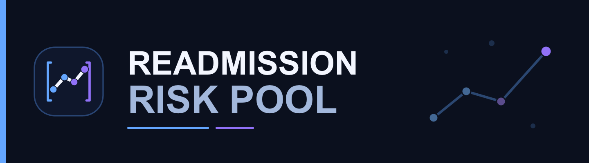
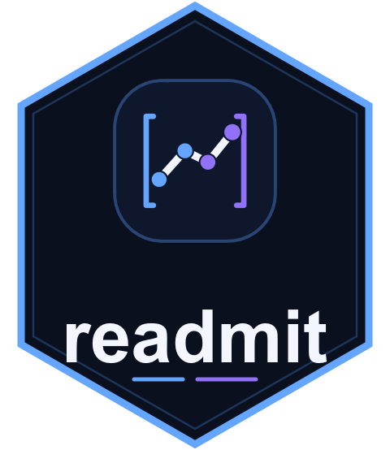

<!-- README.md is generated from README.Rmd. Please edit that file -->



# Readmission Risk Pool 

Hospital readmission risk can change after discharge as time passes and
new information becomes available. A prediction made only at discharge
cannot show how the remaining risk evolves during follow-up.

**Readmission Risk Pool (RRP)** is an analytical platform for
reassessing that risk at chosen times and retaining what each assessment
found. **`readmit`** is the R package used to create and operate an
organization’s RRP project.

<!-- badges: start -->

[](https://cran.r-project.org/package=readmit)

[](https://app.codecov.io/gh/centralstatz/readmit)
[](https://github.com/centralstatz/readmit/actions/workflows/R-CMD-check.yaml)
<!-- badges: end -->

## How RRP works

For an episode still within follow-up and without a known readmission or
death, each assessment concerns the remaining probability of a **first
hospital readmission strictly after the assessment time and through 30
elapsed days after the original discharge**. The endpoint stays fixed;
another assessment does not start a new 30-day window. The estimate
should use information available at that time. For eligibility,
`readmit` distinguishes when a readmission or death occurred from when
it became known, so later knowledge does not rewrite an earlier
assessment.

Repeated assessments retain accepted estimates, provider failures, and
ineligible episodes in project history. This history shows what was
assessed at each time rather than only the latest result.

## What the platform provides

An RRP project is an ordinary, organization-owned directory with
configuration, source-mapping and risk-provider scripts, and its own
Shiny application. `readmit` defines canonical inputs for discharge
episodes and terminal events, applies shared eligibility rules, retains
completed assessments, and derives three analytical products: current
remaining risk, recorded risk trajectories, and an operational summary.
The project application explores those products.

## Get started

This repository contains the RRP `1.0.0` release source. The [CRAN
`readmit` 0.0.1 package](https://cran.r-project.org/package=readmit)
contains earlier, substantially different functionality under an MIT
license; it does not install RRP. Until the RRP release is available on
CRAN, install this repository version from GitHub:

``` r
install.packages("remotes")
remotes::install_github("centralstatz/readmit")
```

Choose a new project path whose parent directory already exists:

``` r
library(readmit)

project <- rrp_project_init(
  path = "my-rrp-project",
  project_id = "my-project"
)
rrp_project_validate(project)
```

The initializer creates editable project guidance, configuration,
branding, two authoring scripts, and a Shiny app. The scripts start as
deliberate stubs. Validation checks that the structure and functions
load; it does not run them or establish that assessments are ready.

## Using an RRP project

Implement `R/produce-canonical.R` to map your source data to the
required discharge episodes and terminal events, and
`R/calculate-risk.R` to provide risk estimates for eligible episodes.
`rrp_state_init(project)` creates persistent history and
`rrp_project_status(project)` reports project state; both can be used
before those scripts are implemented. Once they work,
`rrp_run(project, as_of_time)` records an assessment at a specified UTC
time. Use `rrp_inspect_history(project)` to examine retained results
after state initialization, and `rrp_refresh_products(project)` to
derive products after at least one completed run. Refresh does not run
another assessment.

The application can open before products exist and will show empty
views. Install its runtime packages (`shiny`, `bslib`, `reactable`,
`plotly`, and `yaml`), then launch it with
`shiny::runApp(file.path(project, "app"))`. After a product refresh, the
app reads the generated products.

## Responsibilities and documentation

Your organization supplies source mapping and a risk provider, evaluates
whether its data and model are suitable for the intended use, and
decides how results inform clinical or operational decisions. `readmit`
supplies the analytical structure around those inputs; it does not
include a clinically validated prediction model or establish that using
RRP improves outcomes.

For function reference, use `help(package = "readmit")` after
installation. Each generated project’s `README.md` explains the
canonical contract, risk provider, and application in more detail.
